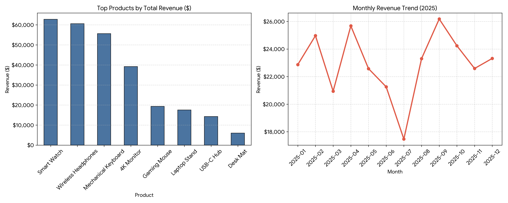

# Sales Dashboard Analysis

A Python-based sales performance analytics pipeline built with Pandas and Matplotlib.

## Project Overview
This project processes transaction records to determine total gross revenue, top-performing product categories, and temporal revenue trends over a 12-month period.

## Dashboard Visualization

## Key Findings
- **Total Gross Revenue:** $275,370.03 across 1,200 records.
- **Top Product Driver:** Smart Watch ($62,796.86), followed by Wireless Headphones ($60,593.94) and Mechanical Keyboards ($55,635.72).
- **Peak Performance:** September reached peak monthly revenue ($26,177.40).
- **Trough Period:** July experienced a sharp seasonal dip ($17,467.88), indicating an opportunity for mid-year promotional campaigns.

## Project Structure
- `sales_analysis.py`: Main processing script containing loading, aggregation, and plotting functions.
- `sales_data.csv`: Source transactional sales dataset.
- `sales_dashboard.png`: Generated visual dashboard (bar chart & line chart).
